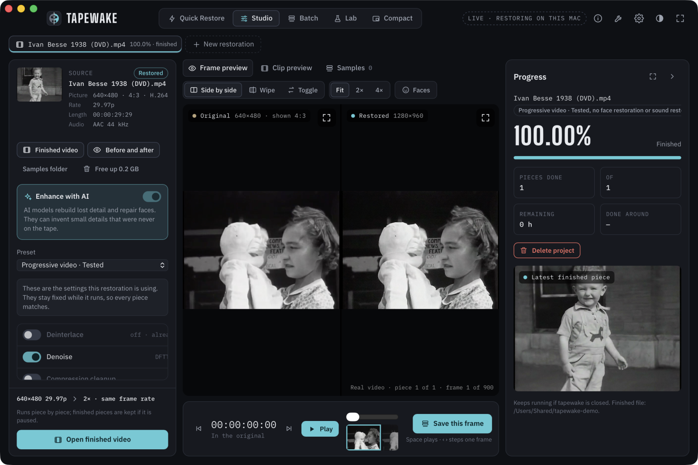
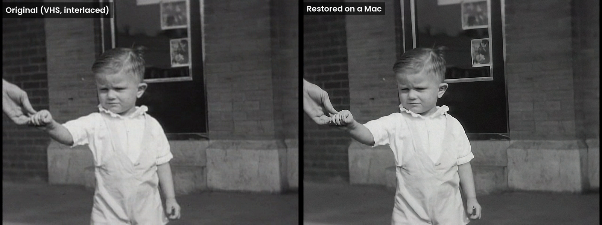
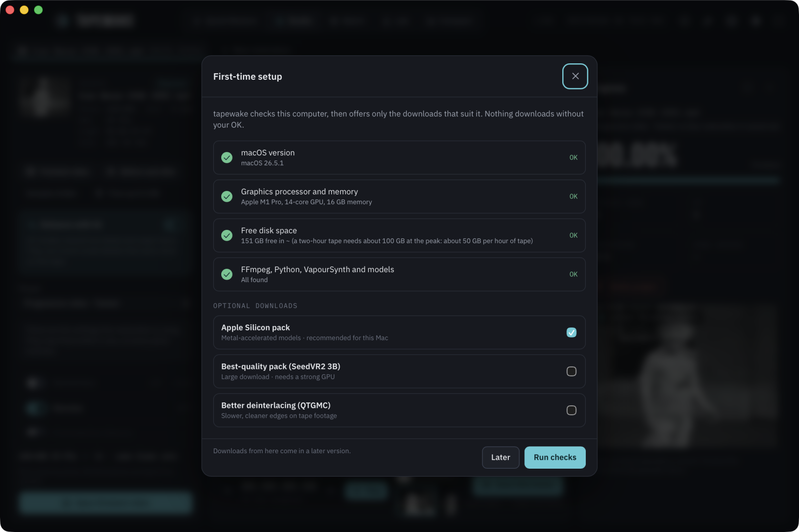
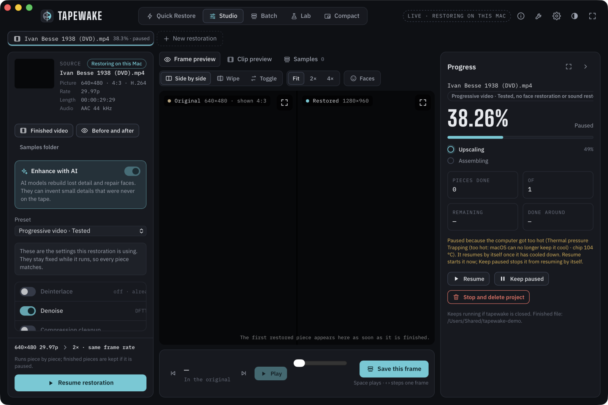
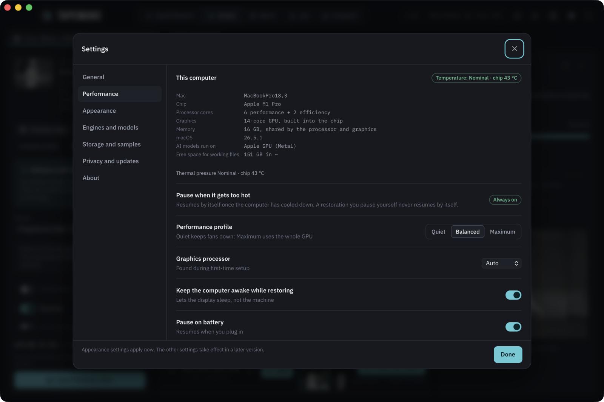
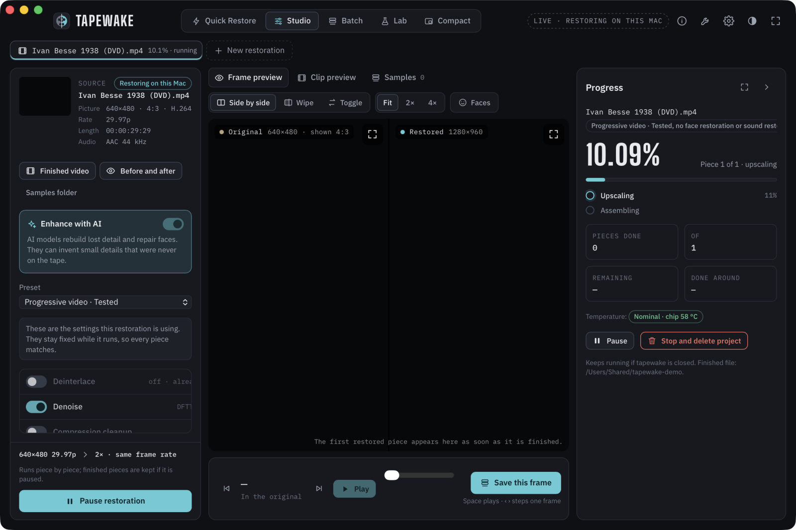
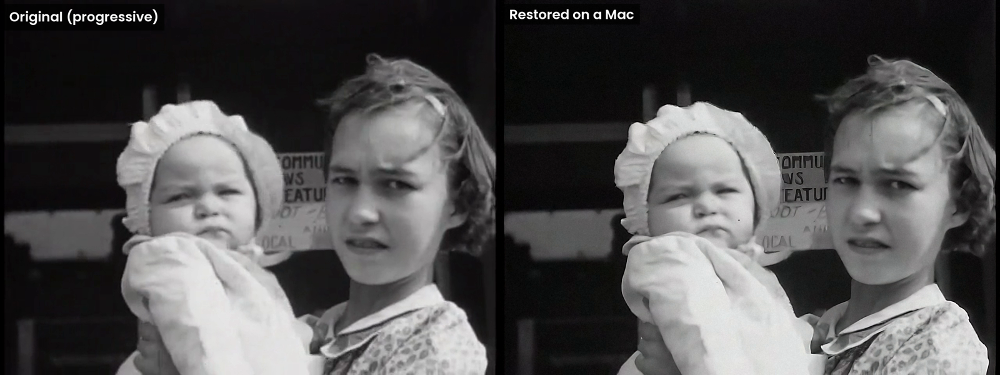

# tapewake on a Mac

tapewake also runs on Macs with Apple Silicon. It's the same app and the same restoration engine as on Windows:
the AI models run on the Mac's own graphics processor (Metal) instead of an NVIDIA card. Everything stays on your
Mac, nothing is uploaded.

The Mac version is new and has had less testing than the Windows one. Read the warnings below before you start a
whole tape. **The latest Mac release is 0.2.0** (`git checkout macos-v0.2.0`); see [Releases](README.md#releases).





## Will it run on my Mac?

| | Needed | Why |
|---|---|---|
| Chip | **Apple Silicon** (M1 or later) | The models run on its graphics processor. **Intel Macs are not supported.** |
| macOS | **15 (Sequoia) or later** | Several of the deinterlacing plugins are only built for macOS 15 and up. |
| Memory | **16 GB or more** | The models share memory with everything else on a Mac. **8 GB Macs are not supported.** |
| Free space for the tools | about 20 GB | FFmpeg, two Pythons and the AI models. |
| Free space per restoration | about **50 GB per hour of tape** at the peak | See [Disk space](#disk-space). |

To check your Mac: Apple menu → **About This Mac** shows the chip, the memory and the macOS version.

tapewake checks all of this itself. **Settings → Setup check** shows a red line for anything that doesn't fit, and
**Restore video** refuses to start (and says why) on a Mac that can't do it or a disk that's too full for that video.
**Settings → Performance** shows your Mac's chip, processor and graphics cores, memory, free space and how hot it is.



## Before you use it

- **It's slow.** Restoring takes many times the length of the video; see [How long it takes](#how-long-it-takes).
  Try a short clip (under a minute) before a whole tape.
- **Keep the Mac plugged in.** A restoration keeps the graphics processor busy for hours or days, and it will
  drain a battery quickly.
- **Don't close the lid of a MacBook.** tapewake keeps the Mac awake while it restores, but macOS still puts a
  laptop to sleep when the lid closes. The screen can turn off on its own; that's fine. If it does sleep, nothing is
  lost: press **Resume** and it carries on from the last finished part.
- **It gets warm.** Fans will run on a MacBook Pro; a MacBook Air (no fan) slows itself down when hot, which makes
  restorations take longer. See [If it gets too hot](#if-it-gets-too-hot).
- **Close big programs** (browsers with many tabs, video editors) while it restores: they share the same memory.
- **The app isn't signed.** A copy you build yourself opens normally. A copy someone else built needs a
  right-click → **Open** the first time, because macOS doesn't know who made it.
- **The face models are for non-commercial use only**, like on Windows. See [THIRD_PARTY.md](THIRD_PARTY.md).

## Installing it

There's no download yet; you build it yourself. [BUILDING-macOS.md](BUILDING-macOS.md) has every step. The short
version, once you have [Homebrew](https://brew.sh), Rust, Node.js and Apple's command-line tools:

```bash
git clone https://github.com/munitkala/tapewake.git
cd tapewake
git checkout macos-v0.2.0
npm install
npm run tauri build -- --bundles app,dmg      # the app, in src-tauri/target/release/bundle/macos/
bash scripts/setup-macos.sh                   # FFmpeg, the Pythons, the models, tools.json
```

Then drag **tapewake.app** into Applications, open it and run **Settings → Setup check**.

## If it gets too hot

macOS keeps track of how hard it's working to stay cool (its "thermal pressure"), and tapewake shows it in
**Settings → Performance** and on the progress card, together with the chip's temperature (the hottest of its
own sensors, for example "Heavy · chip 78 °C"):

| macOS says | What it means | What tapewake does |
|---|---|---|
| Nominal | Cool | Restores |
| Moderate | Warm | Restores |
| Heavy | macOS is slowing the Mac down a little to stay cool. **Normal during a long restoration.** | Restores |
| Trapping or Sleeping | Too hot: macOS can't keep up any more | Pauses after a minute |

When it pauses for heat, the progress card says so and tapewake waits until the Mac is back at Moderate or lower
(at least 5 minutes), then carries on by itself from the last finished part. Pressing **Resume** starts it again
straight away; **Pause** or **Keep paused** stops it from resuming by itself. **A restoration you pause yourself
never resumes by itself.**

Reading macOS's thermal pressure and the chip's temperature needs no password or extra permission. Apple Silicon
is built to run hot: 80–100 °C under a long restoration is normal, which is why tapewake goes by macOS's own
thermal pressure rather than a fixed temperature. If it keeps pausing, give the Mac more air
(a laptop stand, not a bed or a sofa) and keep it out of the sun.





## How long it takes

Measured on a MacBook Pro with an M1 Pro (14-core GPU, 16 GB):

| Video | Settings | Took | That's |
|---|---|---|---|
| 30 s progressive clip, 640×480 at 29.97 | Progressive video, faces and sound off | 11 min | about 23× its length |
| 20 s NTSC tape clip, interlaced, close-up faces almost throughout | Home-video tape, faces on | 99 min | about 300× its length |

Most of the tape clip's time went on face restoration (about 79 minutes), then upscaling (13), finding faces (4)
and putting it together (2). That clip is about as slow as it gets, because there's a close face in nearly every
frame. As a rough guide, **an hour of tape could take one to two weeks** on this Mac, less with fewer faces or with
face restoration off.

For comparison, the Windows PC with an 8 GB NVIDIA card took about 4× the length for progressive video and 2–3 days
per hour of tape. On this Mac the upscaling runs at about 1.6 frames a second, roughly 4× slower than the NVIDIA card
with TensorRT. Faster chips (M2/M3/M4 Pro, Max and Ultra) have more graphics cores and should be quicker, but they
haven't been measured.

Face restoration is the slowest step, so a tape with lots of close-up faces takes longer than one without.





## Disk space

The same as on Windows: about **50 GB per hour of tape** at the peak (about 100 GB for a two-hour tape), and the
restored video is about 17.5 GB per hour. Progressive videos need less at the same size, but more for bigger
pictures (a 1080p film needs several times as much). tapewake works out what each video needs and tells you before
it starts if there isn't room.

To put the working files on an external drive, add this to
`~/Library/Application Support/com.tapewake.app/tools.json`:

```json
"work_root": "/Volumes/YourDrive/tapewake-work"
```

Use a fast drive (SSD); a slow USB stick or network drive makes everything crawl.

## How the Mac version differs

- **Graphics processor:** PyTorch's Metal backend instead of CUDA. Anything Metal can't do yet runs on the
  processor for that step instead.
- **No TensorRT** (NVIDIA only), so the upscaler always runs in plain PyTorch.
- **Denoiser:** dfttest2's portable build instead of its x86 one. Same plugin, same settings.
- **Files:** settings, jobs and the player cache live in `~/Library/Application Support/com.tapewake.app/`, the
  tools in `~/tapewake-tools/`. **Finish and show the file** opens the Finder with the restored video selected.

## What hasn't been tested on a Mac yet

- **Sound restoration.** Both test clips were silent films, so the voice and music cleanup hasn't run on a Mac
  yet. If it fails, turn **Audio** off: the original sound is kept as it is.
- **A whole tape.** Only short clips have been restored so far.
- **The KEEP and CodeFormer face models.** They load on a Mac, but only DicFace (the default) has restored a clip.
- **Macs other than an M1 Pro with 16 GB.**

If something goes wrong, **Troubleshoot → Open this job's log** shows the last thing that happened. Please open an
issue with those lines (remove anything private first) and your Mac's chip, memory and macOS version.

## Uninstalling

1. Drag **tapewake** from Applications to the Bin.
2. Delete `~/tapewake-tools` (the Pythons and models, about 15 GB).
3. Delete `~/Library/Application Support/com.tapewake.app` (settings, the job list and the player cache).
4. Restored videos stay next to the originals; delete any `<name> - tapewake work` folders you no longer need.

Homebrew's FFmpeg, uv and Git LFS stay installed; `brew uninstall ffmpeg-full uv git-lfs` removes them.
