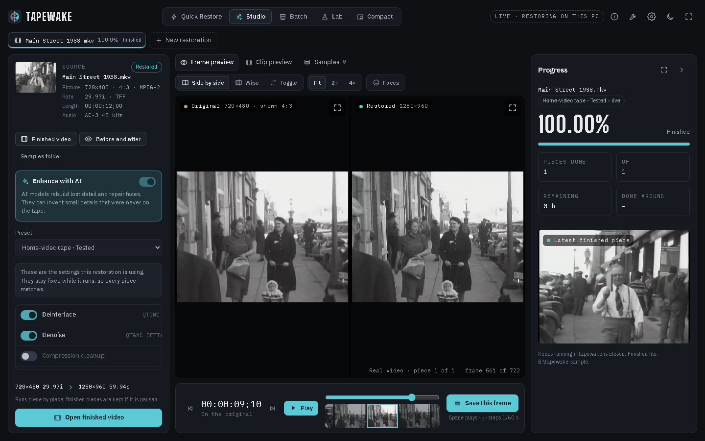

# tapewake on Windows

Windows is where tapewake started and where it's been tested most: its settings were tuned on a full two-hour VHS
tape on a Windows PC with an 8 GB NVIDIA card. The AI models run on the NVIDIA card (CUDA), with TensorRT for faster
upscaling if it's installed.

For what tapewake does and the things to know before using it, see the main [README](README.md). This page is
what's specific to Windows.

**The latest Windows release is 0.1.5** (`git checkout windows-v0.1.5`). The heat pause and the computer details
in Settings described below are on `main` but not in a Windows release yet: they haven't been tried on a Windows
PC. See [Releases](README.md#releases).



## Will it run on my PC?

| | Needed | Why |
|---|---|---|
| Windows | **Windows 10 (2004 or later) or Windows 11**, 64-bit | |
| Graphics | **NVIDIA card with 8 GB or more**, recent driver (530 or newer) | The AI models run on it (CUDA). **AMD and Intel graphics aren't supported yet.** |
| Free space for the tools | about 20 GB | FFmpeg, two Pythons and the AI models. |
| Free space per restoration | about **50 GB per hour of tape** at the peak | See [Disk space](README.md#disk-space). The working files can go on another drive. |

To check your PC: **Settings → System → About** shows the Windows version; **Task Manager → Performance → GPU**
shows the graphics card and its memory.

tapewake checks this in **Settings → Setup check** (one line each for Windows, the graphics card, free space and the
tools), and **Settings → Performance** shows the processor, graphics card, memory and the card's temperature.

## How long it takes

| Video | Settings | Took |
|---|---|---|
| Two-hour VHS tape, NTSC | Home-video tape, faces and sound on, 8 GB NVIDIA card with TensorRT | several days (about 2–3 days per hour of tape) |
| 90-second DVD clip, 720×462 | Progressive video, faces and sound off | about 4× the clip's length |

Without TensorRT the upscaling takes about twice as long.

## Installing it

There's no installer to download yet; you build it yourself. [BUILDING.md](BUILDING.md) walks through everything:
building the app, FFmpeg, the two Python environments, the models and `tools.json`. Budget an hour or two plus
download time.

The short version, for the app itself (needs Rust, the Visual Studio C++ build tools and Node.js):

```
git clone https://github.com/munitkala/tapewake.git
cd tapewake
git checkout windows-v0.1.5
npm install
npm run tauri build -- --bundles nsis
```

The installer ends up in `src-tauri\target\release\bundle\nsis\`.

## Where things are

- **Settings, jobs and the player cache:** `%LOCALAPPDATA%\com.tapewake.app\` (paste that into Explorer's address
  bar). `tools.json` there says where FFmpeg, the Pythons and the models are.
- **The tools:** `C:\tapewake-tools` if you followed BUILDING.md.
- **Working files:** next to the video, or in `work_root` from `tools.json` (point it at your biggest drive).
- **The restored video:** next to the original, as `<name> - Restored.mkv`. **Finish and show the file** opens
  File Explorer with it selected.

## While it restores

- tapewake keeps Windows from going to sleep while it restores (the screen can still turn off). On a laptop, keep it
  plugged in.
- **If the graphics card gets too hot** (it starts slowing itself down because of heat, or reaches 90 °C) for a
  minute, tapewake pauses the restoration and waits. Once the card is back at 75 °C or less it carries on by itself.
  Pressing **Pause** or **Keep paused** while it waits stops that: a restoration you pause yourself never resumes by
  itself. This is new and so far has only been tried on a Mac; on Windows it reads the card through `nvidia-smi`,
  which comes with the NVIDIA driver.
- Close games and other programs that use the graphics card. They compete for its memory and can make a step stop
  with an out-of-memory error (pause and resume to carry on).

## What's specific to Windows

- **Graphics:** CUDA on the NVIDIA card. **TensorRT** (optional) makes upscaling about twice as fast; the first
  upscale builds an engine for your card, which takes a few minutes.
- **FFmpeg:** tapewake finds a copy installed with `winget install Gyan.FFmpeg` by itself.
- **The denoiser:** dfttest2's x86 build (`dfttest2_cpu`).
- **The interface** is drawn by Microsoft Edge WebView2, which is part of Windows 10 and 11.

## If something goes wrong

[BUILDING.md](BUILDING.md#if-something-goes-wrong) has the common problems (a red line in the setup check, the
graphics card not found, running out of graphics memory). Otherwise, **Troubleshoot → Open this job's log** shows the
last thing that happened. If you open an issue, include those lines (remove anything private first) and your
graphics card and Windows version.

## Uninstalling

1. **Settings → Apps → Installed apps → tapewake → Uninstall.**
2. Delete `C:\tapewake-tools` (the Pythons and models).
3. Delete `%LOCALAPPDATA%\com.tapewake.app` (settings, the job list and the player cache).
4. Restored videos stay next to the originals; delete any `<name> - tapewake work` folders you no longer need.
