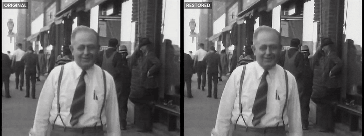
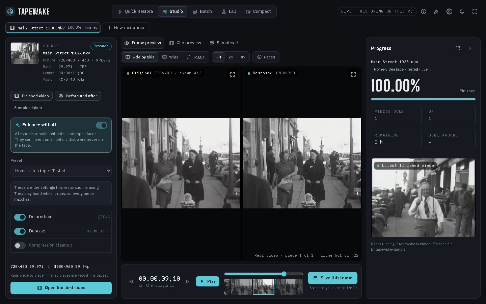
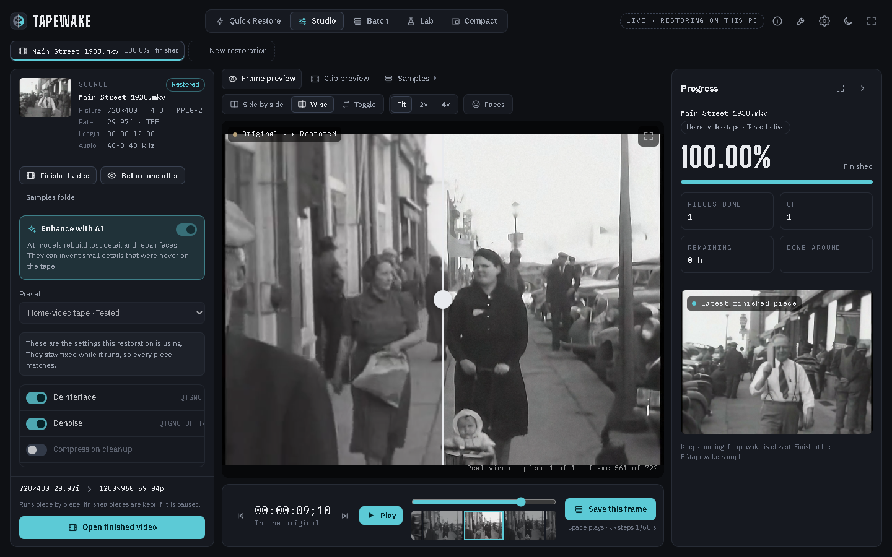
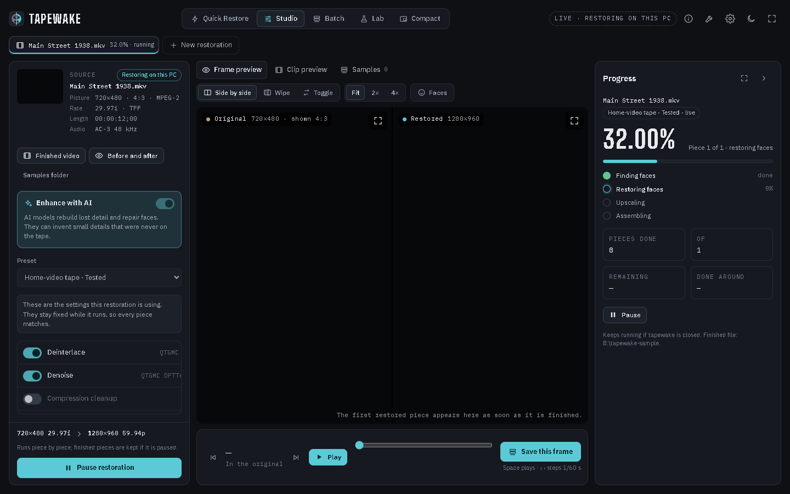
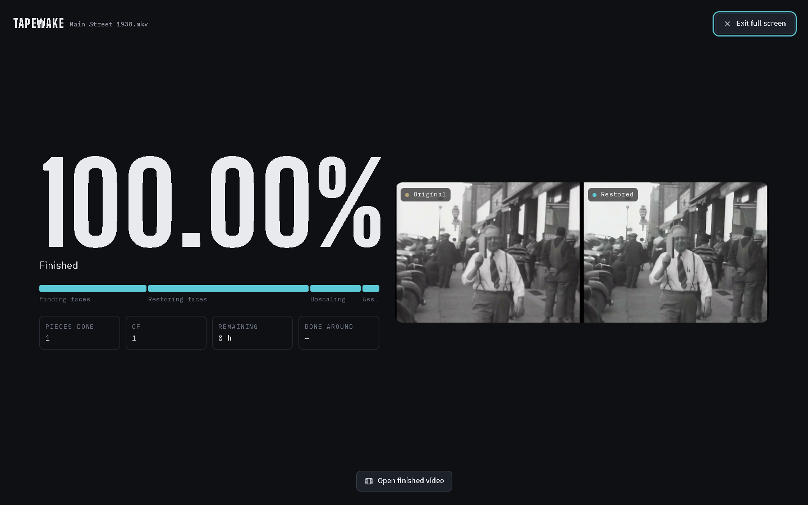
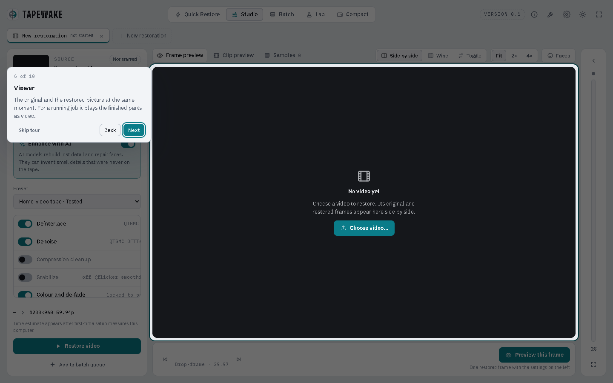
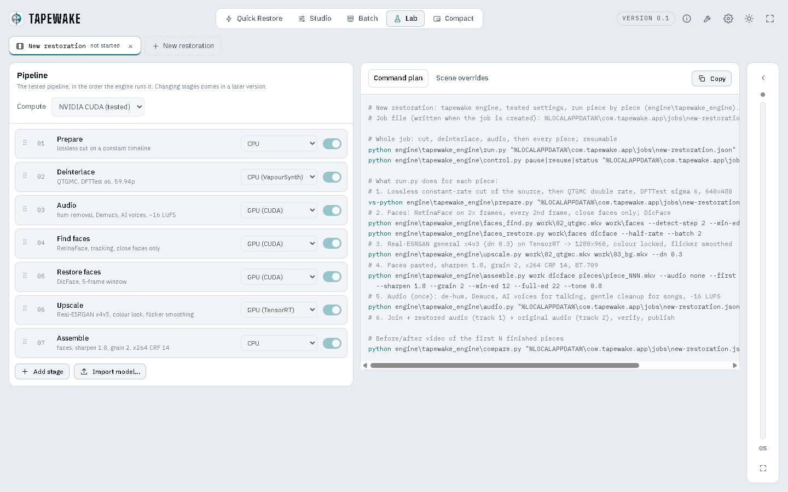

# tapewake

**Local video restoration.** Free and open source (MIT licence).


tapewake restores old VHS and home videos on your own computer: it deinterlaces the tape, upscales it with AI,
restores faces carefully, cleans up the sound, and gives you the restored film plus a before-and-after comparison.
Nothing is uploaded anywhere.



## What it does

- Restores home-video tapes (interlaced NTSC, 4:3) with settings proven on a full two-hour VHS tape: QTGMC
  deinterlacing, Real-ESRGAN upscaling to 1280×960 at 59.94 fps, face restoration that keeps likeness, gentle grain,
  and sound restoration.
- Works piece by piece and can be paused and resumed at any time; finished parts are kept and checked.
- Shows each restoration live, with a player that plays the finished parts next to the original
  (side by side, wipe, or hold-to-compare) and a filmstrip.

| | |
|---|---|
|  |  |
|  |  |
|  |  |

## Status

Version 0.1, Windows only, needs an NVIDIA card. There's no installer to download yet, and the app doesn't
install its tools for you yet, so for now it's for people comfortable setting things up by hand.

## Requirements

- Windows 10 (2004 or later) or Windows 11, 64-bit
- NVIDIA graphics card with 8 GB or more
- Free disk space: about **50 GB per hour of tape** at the peak, so about 100 GB for a two-hour tape. The
  working files can go on another drive. Most of them are deleted as the restoration goes; once it's
  finished, **Free up space** deletes the rest (about 30 GB per hour of tape), leaving only the restored
  video (about 17.5 GB per hour). See [engine/README.md](engine/README.md#disk-space)
- Patience: the two-hour test tape took several days

## Building it

[BUILDING.md](BUILDING.md) walks through everything step by step, from cloning this repo to the first
restoration: building the app, FFmpeg, the two Python environments, the models and `tools.json`.

The short version, for the app itself (needs Rust, the Visual Studio C++ build tools and Node.js):

```
git clone https://github.com/munitkala/tapewake.git
cd tapewake
npm install
npm run tauri build -- --bundles nsis
```

## What's where

| Path | What it is |
|---|---|
| `ui/index.html` | The whole interface, one file (HTML/CSS/JS, no framework) |
| `src-tauri/` | The desktop app (Tauri 2, Rust): window, file picker, the bridge to the engine |
| `engine/tapewake_engine/` | The restoration engine (Python) |
| `engine/app_bridge.py` | How the app talks to the engine |
| `engine/presets/vhs-tested.json` | Every setting of the tested preset |
| `assets/` | Logo |

The engine also runs without the app: `python engine\tapewake_engine\run.py <job file>`.

## Example footage

The example clip is from *Amateur films: Ivan Besse collection, Britton, South Dakota 1938–39 (Part X)*, Prelinger
Archives, via the Internet Archive (archive.org/details/sIvanBes1938_10), public domain.

## Credits

tapewake builds on these open-source projects. Thank you to their authors. Each keeps its own licence. None of them
is part of this repository, and their authors are not involved with tapewake.

| Project | Used for | Licence |
|---|---|---|
| [FFmpeg](https://ffmpeg.org) | Reading, cutting and encoding video and sound | GPL-3.0 (build used) |
| [VapourSynth](https://www.vapoursynth.com) and [vs-jetpack](https://github.com/Jaded-Encoding-Thaumaturgy/vs-jetpack) (QTGMC) | Deinterlacing | LGPL-2.1 / MIT |
| VapourSynth plugins: mvtools (mvutensils), znedi3, dfttest2, bestsource, akarin, resize2, zsmooth, vszip | Parts of QTGMC | GPL / LGPL / MIT |
| [Real-ESRGAN](https://github.com/xinntao/Real-ESRGAN) weights | Upscaling | BSD-3-Clause |
| [CodeFormer](https://github.com/sczhou/CodeFormer) | Finding, aligning and checking faces; optional face model | S-Lab License 1.0 (non-commercial) |
| [DicFace](https://github.com/fudan-generative-vision/DicFace) | Face restoration | S-Lab License 1.0 (non-commercial) |
| [KEEP](https://github.com/jnjaby/KEEP) | Face restoration (alternative) | S-Lab License 1.0 (non-commercial) |
| [Demucs](https://github.com/facebookresearch/demucs) | Separating voices from noise | MIT |
| [DeepFilterNet](https://github.com/Rikorose/DeepFilterNet) | Cleaning up voices | MIT / Apache-2.0 |
| [Resemble Enhance](https://github.com/resemble-ai/resemble-enhance) | Enhancing voices | MIT |
| [PyTorch](https://pytorch.org) and torchvision (RAFT) | Running the AI models | BSD-3-Clause |
| [OpenCV](https://opencv.org), NumPy, SciPy, psutil | Image and signal processing, process control | Apache-2.0 / BSD |
| [NVIDIA TensorRT](https://developer.nvidia.com/tensorrt) (optional) | Faster upscaling | NVIDIA licence |
| [Tauri](https://tauri.app) | The desktop app | MIT / Apache-2.0 |
| IBM Plex, Big Shoulders Display, Poppins | Fonts | SIL Open Font License |

The face models (CodeFormer, DicFace, KEEP) may only be used for non-commercial purposes, so tapewake will stay free
while it uses them. The full list with versions is in [THIRD_PARTY.md](THIRD_PARTY.md).

## About this project

tapewake is a hobby project. I first started writing it to restore my parents' wedding video, and it grew into
something anyone can use for their own tapes. Part of the development was done with the help of Claude, an AI
assistant. It's looked after in my spare time, so replies to issues and pull requests may take a while.

All the code in this repository was written for tapewake and is mine to release under the MIT licence. Other
projects are only used, never copied in, and they're credited above. That said, this is a hobby project and I'm not
an expert programmer, so I may have missed something obvious. I have no intention of including anything that isn't
mine. If you spot code here that comes from somewhere else, please let me know by opening an issue, and I'll make
sure it's credited and licensed properly, or remove it.

## Before you use it

Please read this before restoring anything you care about.

- **No warranty.** tapewake is free software provided "as is" (see `LICENSE`). You use it at your own risk. The
  authors aren't responsible for lost or damaged footage, damage to your computer, or anything else that happens
  from using it.
- **Keep your originals.** tapewake never changes the source file, but always keep your original tapes and a copy
  of every file you restore.
- **Restored footage is not the original.** The AI upscaling and face restoration add detail that was never on the
  tape. Faces in particular can end up looking slightly different from the real person. Don't use restored footage
  as evidence or as an exact record of what happened, and say that it's been restored when you share it.
- **Only restore footage you have the right to use**, and respect the privacy of the people in it. tapewake works
  entirely on your computer and doesn't upload anything.
- **Other people's licences apply.** tapewake uses separately installed programs and AI models, each under its own
  licence (see [THIRD_PARTY.md](THIRD_PARTY.md)). You're responsible for following them. In particular the face
  models are **non-commercial only**: you can't use tapewake's face restoration for paid work, such as a
  restoration service, without permission from their authors.
- **It works your computer hard.** A restoration keeps the graphics card at full load for hours or days. Make sure
  your PC is well cooled, and don't leave it running somewhere a hot computer could be a problem.
- **No affiliation.** Names of other projects and products belong to their owners. Their authors don't endorse
  tapewake.
- This section isn't legal advice. If you're unsure whether your use is allowed, ask someone qualified.

## Contributing

Bug reports and pull requests are welcome, see [CONTRIBUTING.md](CONTRIBUTING.md). Security problems:
[SECURITY.md](SECURITY.md).

## Licence

MIT (see `LICENSE`). This covers tapewake's own files only, not the projects listed under Credits.
